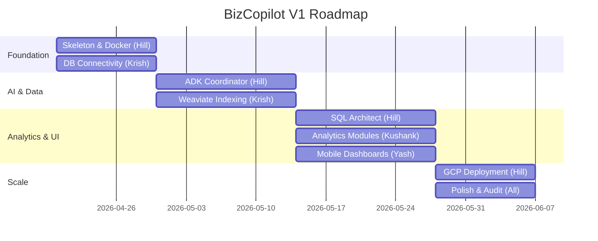

# 👥 Team Division — BizCopilot

This document defines the roles, responsibilities, and phase-wise ownership structure for the **BizCopilot** project, optimized for a 4-member development team.

---

## 🏗️ The Four Development Streams

BizCopilot is divided into four parallel workstreams. Success depends on the **Phase 1 Foundation** being landed first to unblock the rest of the team.

### Dev 1: Foundation + Core AI Orchestrator (Lead)
**Owner:** Hill
**Focus:** System Architecture, Google ADK, and the "Cloud-Native Mirror" environment.

| Phase | Task | Deliverables |
| :--- | :--- | :--- |
| **Phase 1** | **Project Skeleton & Docker** | `docker-compose.yml`, FastAPI boilerplate, Weaviate setup. |
| **Phase 2** | **ADK Coordinator** | Hierarchical agent logic, Gemini 2.5 Pro integration, Intent Routing. |
| **Phase 3** | **Verification & Sandbox** | SQL Audit Agent, Restricted Python Worker, security gates. |
| **Phase 4** | **GCP Production Scale** | Caching (Redis), GCP deployment scripts, E2E Security. |

---

### Dev 2: Data Engineering & Schema Indexing
**Owner:** Krish
**Focus:** Database Connectivity, Catalog Introspection, and Weaviate RAG Indexing.

| Phase | Task | Deliverables |
| :--- | :--- | :--- |
| **Phase 1** | **PostgreSQL Connector** | Catalog crawling logic (`information_schema`), connection pooling. |
| **Phase 2** | **Weaviate Indexing Pipeline** | Schema embedding logic, automated metadata ingestion. |
| **Phase 3** | **Query Optimization** | Indexing strategies for target DBs, read-only session management. |
| **Phase 4** | **Schema Drift Management** | Automated re-indexing on schema change, metadata lifecycle. |

---

### Dev 3: Analytics Logic & Insight Synthesis
**Owner:** Kushank
**Focus:** KPI Frameworks, Python Analysis Modules, and Narrative Synthesis.

| Phase | Task | Deliverables |
| :--- | :--- | :--- |
| **Phase 1** | **KPI Definitions** | Standardized metric logic (Revenue, Trends, etc.) for V1. |
| **Phase 2** | **Semantic Mapping** | Business-logic descriptions for schema elements (for RAG). |
| **Phase 3** | **Analysis & Viz Specs** | Python modules for Pandas/Scipy, JSON spec for Charts. |
| **Phase 4** | **Insight Validation** | Accuracy testing (90%+ goal), Narrative style fine-tuning. |

---

### Dev 4: Frontend & Mobile Integration
**Owner:** Yash
**Focus:** Android (Kotlin/Compose), Web (React), and Conversational UI.

| Phase | Task | Deliverables |
| :--- | :--- | :--- |
| **Phase 1** | **Client Skeleton** | Android/Web boilerplate, Auth screens, Networking layer. |
| **Phase 2** | **Conversational UI** | Real-time chat interface, message persistence, multi-turn state. |
| **Phase 3** | **Visualization Rendering** | Dynamic chart components (Bar, Line, Pie), Status "thought" indicators. |
| **Phase 4** | **Dashboard & UX Polish** | Insight alerts (Push notifications), final UX refinements. |

---

## 🔄 Critical Coordination Points (Handoffs)

| ID | From | To | Signal | Timing |
| :--- | :--- | :--- | :--- | :--- |
| **C1** | **Hill (Phase 1)** | **All** | Docker & Skeleton merged. | Day 2 |
| **C2** | **Krish (Phase 2)** | **Hill** | Schema metadata indexed in Weaviate. | Week 4 |
| **C3** | **Kushank (Phase 3)** | **Yash** | Chart JSON Spec finalized. | Week 6 |
| **C4** | **Hill (Phase 3)** | **Kushank** | Python Sandbox ready for test modules. | Week 5 |

---

## 📅 Timeline (8-Week Sprint)

---

## ⚠️ Ownership Rules
1. **Module Sovereignty:** Each stream lead has final say on their module's implementation.
2. **API First:** Backend must provide Swagger/OpenAPI stubs before Phase 2 starts.
3. **Fail Fast:** If introspection fails on a complex schema, Krish must flag it immediately to Hill.
